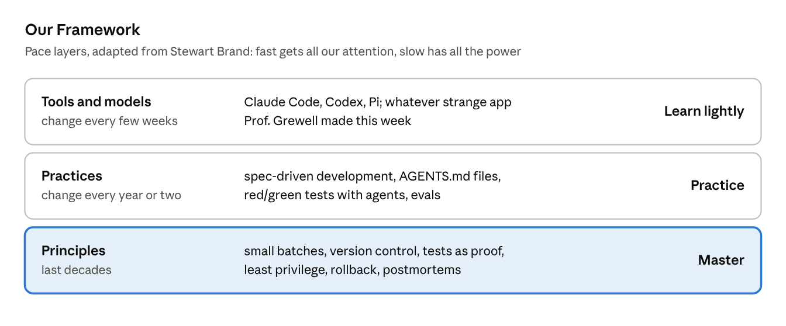

# Building with AI (TECH-GB 2160 · Fall 2026)

**NYU Stern · Tuesdays 9:00–11:50 AM · KMC 3-70**  
Instructor: Christian Grewell (`christian@nyu.edu`) · TF: Hew (`mwm8816@nyu.edu`)  
Course site: **[icerynk.com](https://www.icerynk.com)**

---

### Quick Start for Students

1. **Start your project repo:** Open **[`project-template`](https://github.com/building-with-ai-f26/project-template)** and click the green **"Use this template" → "Create a new repository"** button.
   - Set **Owner** to `building-with-ai-f26`
   - Name your repo `<your-netid>-<project-slug>` (e.g., `cg123-invoice-bot`)
   - Set visibility to **Public** (unlocks unlimited GitHub Actions and free GitHub Pages for your Demo Day landing page)
2. **Never commit secrets:** Keep your OpenRouter / API keys in `.env` (already ignored by `.gitignore`). If you ever commit a key by mistake, revoke it immediately on [OpenRouter](https://openrouter.ai/).
3. **Work in small batches:** Use branches and Pull Requests. Every PR includes a short human-written check: *what changed, why, what could break, and which test proves it.*

---

### Schedule & Weekly Builds (Due Mondays @ Noon)

| # | Date | Session Topic | Build Deliverable (Due Mondays @ Noon) |
| :-: | :--- | :--- | :--- |
| **1** | Oct 27 | **`Intent.md`** — *Who is it for, and what job does it do?* | `Intent.md` brief & throwaway prototype · **Nov 9** |
| – | Nov 3 | *No class (Election Day)* | — |
| **2** | Nov 10 | **`Plan.md`** — *What's the riskiest part, and what will it cost?* | Smallest working version live + `Plan.md` + `AGENTS.md` · **Nov 16** |
| **3** | Nov 17 | **`Build.exe`** — *Can you explain every change you ship?* | Core workflow shipped in small PRs · **Nov 23** |
| **4** | Nov 24 | **`Test.py`** — *What proves it works (code and model)?* | Red/green tests & model evals · **Nov 30** |
| **5** | Dec 1 | **`Ship.installer`** — *Can a stranger use it safely, and can you roll back fast?* | Live product, landing page, & 2-min video · **Dec 7** |
| **6** | Dec 8 | **`Demo Day.`** — *Live demos & peer stress-testing* | Final 1-page sponsor memo (`SPONSOR_MEMO.md`) · **Dec 14** |
